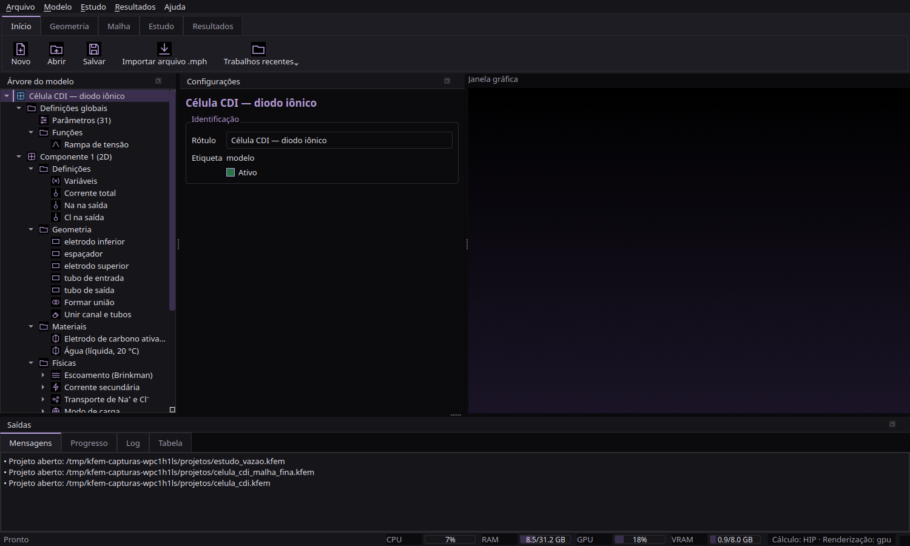
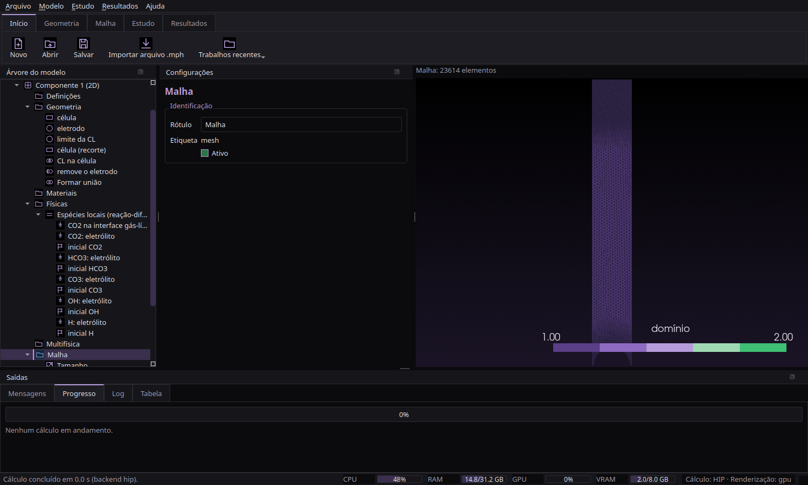

# KFem — Elementos Finitos

Simulador multifísico livre baseado em **FEniCSx (DOLFINx)**, com interface gráfica própria
(tema lilás, verde-escuro e preto), distribuído como **AppImage** para Linux. Detecta a
placa de vídeo e calcula nela quando compensa (montagem de elementos finitos em GPU via HIP),
com volta automática para a CPU.



## Baixar

A versão mais recente está em **[Releases](https://github.com/WalberJr/KFem---Elementos-Finitos/releases)**:
baixe `KFem-x86_64.AppImage` e `KFem-x86_64.AppImage.sha256`.

```bash
sha256sum -c KFem-x86_64.AppImage.sha256
```

```bash
chmod +x KFem-x86_64.AppImage && ./KFem-x86_64.AppImage
```

Requer Linux x86_64 com glibc 2.39+ (Ubuntu 24.04+, Debian 13+ ou Fedora 40+) e o `gcc`
instalado (`sudo apt install gcc`). Para usar a placa de vídeo no cálculo, rode o
`kfem-gpu-setup` (ver o manual).

## O que o KFem faz

| Área | Recursos |
|---|---|
| Geometria | retângulo, disco, polígono e bloco; diferença, interseção e união booleanas |
| Malha | Gmsh: tamanho global e local, faixa fina junto a contornos, camadas-limite |
| Físicas prontas | escoamento em meio poroso (Brinkman), corrente secundária com eletrodo poroso e dupla camada, transporte de espécies diluídas com migração e convecção, equações globais |
| Física livre | **equação personalizada**: qualquer EDP em forma fraca, com várias variáveis e condições de Dirichlet, Neumann e Robin |
| Estudos | estacionário; transiente com BDF2 de passo adaptativo |
| Cálculo | processo separado (a interface não trava), MPI, montagem na GPU (AMD/HIP) conferida contra a CPU |
| Automação | `--solve` sem interface, `--watch` para acompanhar, `--python` para gerar modelos e analisar resultados |
| Interoperabilidade | importação de arquivos `.mph` do próprio usuário; formato de projeto aberto `.kfem` |

## Exemplos

- **Deionização capacitiva (CDI)**: Brinkman, corrente secundária e transporte de Na⁺ e Cl⁻
  em meio poroso, estacionário e transiente.
- **Redução de CO₂ em meio ácido** ([examples/xie2022_co2rr](examples/xie2022_co2rr)):
  reprodução do modelo de Xie et al. (*Nature Catalysis* 5, 564–570, 2022) em 1D e extensão
  a 2D com eletrodos plano, convexo e pontiagudo de mesma área.



## Documentação

- **Manual do usuário** — [PDF](docs/usuario/KFem-Manual.pdf) · [texto](docs/usuario/manual.md):
  tudo o que o programa faz e como fazer (interface, geometria, físicas, equação
  personalizada, estudos, linha de comando, Python, GPU)
- **Tutorial** — [PDF](docs/usuario/KFem-Tutorial.pdf) · [texto](docs/usuario/tutorial.md): a primeira
  simulação, passo a passo
- [Guia de build](docs/build.md) — da fonte ao AppImage
- [Registro de mudanças](CHANGELOG.md)
- [Notas de licença](docs/licencas.md) e [avisos de terceiros](THIRD_PARTY_NOTICES.md)
- Decisões de projeto: [docs/decisions](docs/decisions); formulação física:
  [docs/physics](docs/physics)
- Versões fixadas da pilha: [build/versions.env](build/versions.env)

## Dúvidas e contribuições

Dúvidas de uso: [Discussions](https://github.com/WalberJr/KFem---Elementos-Finitos/discussions).
Erros e pedidos de recurso: [Issues](https://github.com/WalberJr/KFem---Elementos-Finitos/issues).
Contribuições por pull request são bem-vindas.

KFem não é afiliado a nenhum fornecedor de software comercial de simulação.

Licença: [GPL-3.0-or-later](LICENSE).
