# Manual do usuário do KFem

KFem é um simulador multifísico livre (GPL-3.0-or-later) baseado no FEniCSx/DOLFINx. Ele
monta modelos de elementos finitos por uma árvore de modelo (geometria, materiais, físicas,
malha, estudos e resultados), resolve-os em processo separado, com MPI quando há vários
núcleos, e usa a placa de vídeo para calcular quando ela ajuda.

Este manual descreve tudo o que o programa faz e como fazer. Ele vale para a interface
gráfica, para a linha de comando e para a programação em Python. O **Tutorial** (Ajuda →
Tutorial) leva, passo a passo, do zero até um primeiro resultado.

## 1. O que o KFem faz

| Área | O que há |
|---|---|
| Geometria 2D e 3D | retângulo, disco, polígono, bloco; diferença, interseção e união booleanas; remoção de arestas internas |
| Malha | triângulos livres (Gmsh), tamanho global e local, faixa fina junto a contornos, camadas-limite |
| Físicas prontas | escoamento em meio poroso (Brinkman), corrente secundária com eletrodo poroso e dupla camada, transporte de espécies diluídas (difusão, migração, convecção), equações globais (ODEs) |
| Física livre | **Equação personalizada**: qualquer EDP escrita em forma fraca, com várias variáveis, condições de Dirichlet, Neumann e Robin |
| Estudos | estacionário; dependente do tempo com BDF2 de passo adaptativo |
| Parâmetros | expressões com unidades (SI e derivadas), constantes físicas, funções, variáveis e sondas |
| Resultados | campos na janela gráfica, sondas na tabela, exportação PNG e CSV, arquivos XDMF/HDF5 para o ParaView |
| Cálculo | processo separado (a interface não trava), MPI, montagem na GPU (AMD/HIP) com conferência automática |
| Interoperabilidade | importação de arquivos `.mph` do próprio usuário; formato de projeto aberto `.kfem` |
| Automação | `--solve` sem interface, `--watch` para acompanhar, `--python` para gerar modelos e analisar resultados |

## 2. Instalação

### Requisitos

- Linux x86_64 com glibc 2.39 ou mais nova: Ubuntu 24.04+, Debian 13+, Fedora 40+.
- **Compilador C (`gcc`)**: a DOLFINx compila os núcleos de cada modelo na hora.
  - Ubuntu/Debian: `sudo apt install gcc`
  - Fedora: `sudo dnf install gcc`
- FUSE 3 (pacote `fuse3`) para abrir o AppImage direto. Quase sempre já vem instalado;
  sem ele o KFem ainda abre com `--appimage-extract-and-run`, só que mais devagar.

### Instalação pelo pacote de distribuição

O pacote de distribuição (pasta `KFem`) traz o AppImage, a soma SHA-256, os manuais, os
exemplos, o código-fonte e o script `instalar.sh`. Copie a pasta para o disco interno (discos
NTFS ou FAT não guardam a permissão de execução) e rode:

```bash
bash instalar.sh
```

O script confere o SHA-256, copia o KFem para `~/Aplicativos/KFem`, cria o atalho no menu de
aplicativos, confere `gcc`, FUSE e glibc e mostra qual placa será usada. Ele não pede senha;
o que faltar ele só indica.

### Executar sem instalar

```bash
chmod +x KFem-x86_64.AppImage
```

```bash
./KFem-x86_64.AppImage
```

Confira o arquivo contra o `KFem-x86_64.AppImage.sha256` publicado junto:

```bash
sha256sum -c KFem-x86_64.AppImage.sha256
```

Na primeira execução o KFem testa a placa de vídeo (3–5 s) e guarda a escolha em
`~/.cache/kfem/backend.json`. O teste só se repete se o hardware, os drivers ou o KFem mudarem.

## 3. A janela

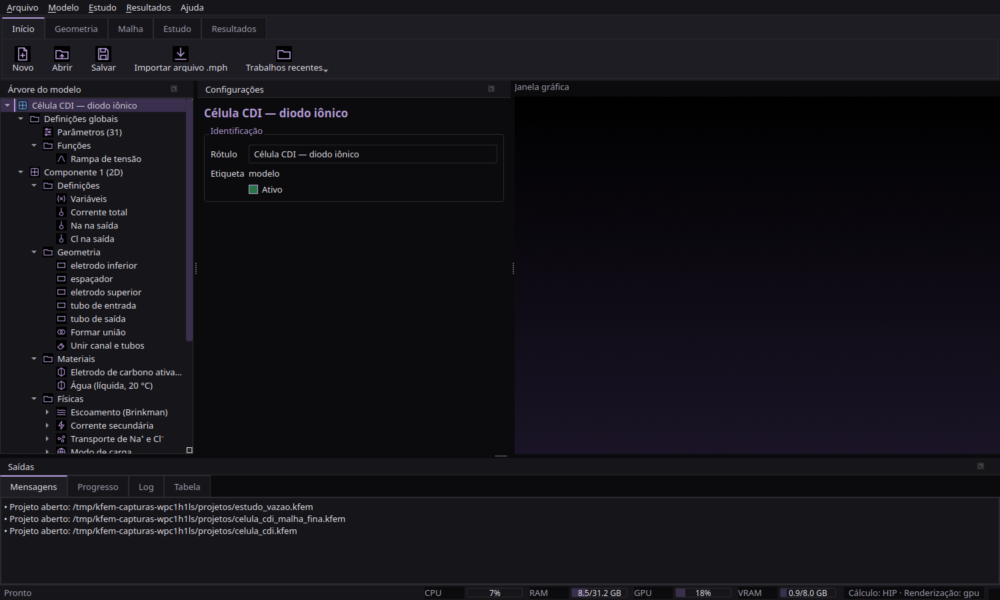

| Região | Para que serve |
|---|---|
| Barra de menus e faixa de abas (Início, Geometria, Malha, Estudo, Resultados) | comandos |
| **Árvore do modelo** (esquerda) | tudo o que compõe o modelo, em ordem: definições globais, componente, geometria, materiais, físicas, multifísica, malha, estudos, resultados |
| **Configurações** (centro) | propriedades do nó selecionado na árvore |
| **Janela gráfica** (direita) | geometria, malha e campos de resultado (desenho na GPU) |
| **Saídas** (embaixo) | abas Mensagens, Progresso, Log e Tabela |
| Barra de status | uso de CPU, RAM, GPU e VRAM; backend de cálculo e de desenho |

Os painéis podem ser soltos e movidos pelo título.

### A árvore do modelo

Clique com o botão direito num nó para **adicionar** filhos (o menu mostra só o que cabe
ali), **ativar/desativar** ou **remover**. Um nó desativado continua salvo no projeto, mas
não entra no cálculo. Cada nó tem um **rótulo** (livre, para você) e uma **etiqueta** (curta,
única, usada para referenciá-lo, por exemplo nas físicas resolvidas de um estudo).

Os nós que agem sobre partes da geometria têm uma **Seleção**: domínios (regiões), contornos
(linhas em 2D, faces em 3D) ou global. Marque **Todos** ou escreva os números, separados por
vírgula (ex.: `1, 5, 9`). A numeração vem da geometria (§6.3).

### Menus e atalhos

| Menu | Comandos |
|---|---|
| Arquivo | Novo (Ctrl+N), Abrir… (Ctrl+O), Salvar (Ctrl+S), Salvar como… (Ctrl+Shift+S), Importar arquivo .mph…, Trabalhos recentes, Sair (Ctrl+Q) |
| Modelo | Pré-visualizar geometria, Gerar malha |
| Estudo | Calcular (F8), Parar cálculo (Shift+F8) |
| Resultados | Abrir resultados, Exportar imagem (PNG)…, Exportar tabela (CSV)… |
| Ajuda | Manual do usuário (F1), Tutorial, Diagnóstico de hardware, Configurar placa de vídeo…, Sobre o KFem |

## 4. Fluxo de trabalho

### Abrir, criar e retomar

- **Início → Trabalhos recentes** lista os projetos abertos ou salvos (até 10, do mais
  recente ao mais antigo). Projetos apagados ou movidos somem da lista; **Limpar lista**
  esvazia.
- **Abrir…** abre um `.kfem` de qualquer pasta. Também é possível abrir pela linha de
  comando: `KFem-x86_64.AppImage projeto.kfem`.
- **Novo** começa um modelo vazio, que você monta pela árvore.
- **Importar arquivo .mph…** converte um modelo do COMSOL seu para `.kfem` (§14).

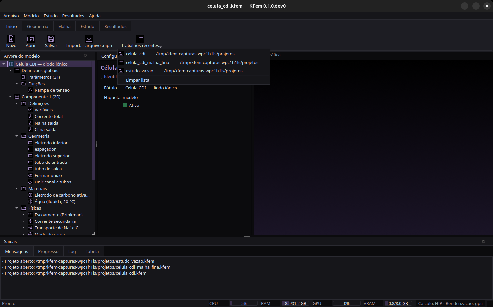

### Montar um modelo, em ordem

1. **Parâmetros** (Definições globais): grandezas com unidade, usadas em todo o modelo (§5).
2. **Geometria** (Componente): primitivas, booleanas e, no fim, **Formar união** (§6).
3. **Materiais**: propriedades por domínio, lidas pelas físicas como `mat:nome` (§5.4).
4. **Físicas**: um nó por física, com os filhos que definem domínios, contornos e valores
   iniciais (§8 e §9).
5. **Malha**: tamanho global, tamanhos locais e o gerador (§7).
6. **Estudo**: um ou mais passos, cada um com as físicas que resolve (§10).
7. **Calcular** e analisar os **Resultados** (§11).

### Calcular

1. Confira a geometria (**Geometria → Pré-visualizar geometria**) e a malha
   (**Malha → Gerar malha**).
2. Na aba **Estudo**, escolha **Processos MPI** (padrão: número de núcleos físicos) e
   **Threads OpenMP** (deixe 1), e clique **Calcular** (F8).
3. Acompanhe na aba **Progresso**. Os campos aparecem na janela gráfica durante o cálculo, e
   a aba **Tabela** recebe as sondas a cada instante de saída.
4. **Parar cálculo** (Shift+F8) interrompe num ponto seguro; a interface continua aberta e
   os instantes já calculados ficam gravados.

O cálculo roda num processo separado: a interface nunca trava, mesmo em cálculos de horas.
Um cálculo iniciado pela linha de comando pode ser acompanhado na interface (§12.2).

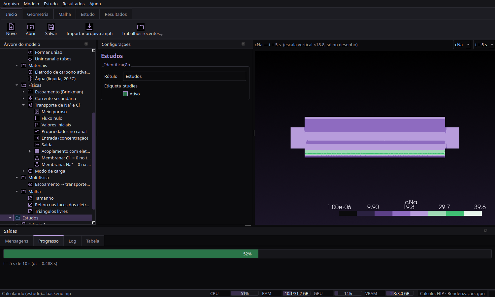

A aba **Log** registra cada etapa: backend escolhido, conferência da montagem em GPU, instantes
de saída, passos rejeitados e o perfil de tempo do Newton ao final.

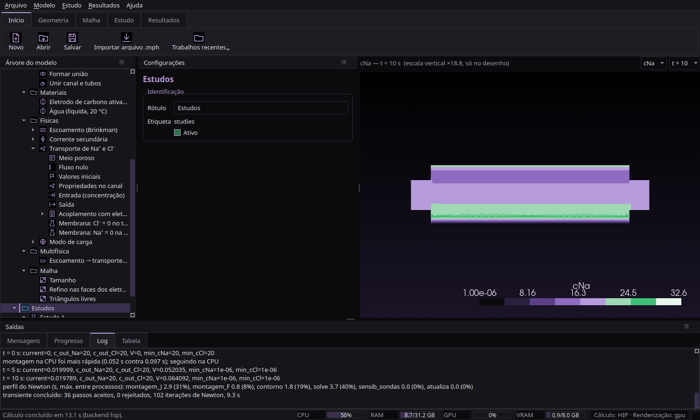

## 5. Parâmetros, expressões e unidades

### 5.1 Parâmetros

Em **Definições globais → Parâmetros**, cada linha tem **nome**, **expressão**, **valor em SI**
(calculado) e **descrição**, organizados em grupos. Um parâmetro pode usar outros:

| Nome | Expressão | Valor em SI |
|---|---|---|
| `W` | `25[mm]` | 0,025 m |
| `L` | `4*W` | 0,1 m |
| `j_app` | `500[mA/cm^2]` | 5000 A/m² |
| `Rrxn` | `j_app*eps/(F_const*2*Lcl)` | calculado |

Dependências circulares são recusadas com aviso. A ordem das linhas não importa.

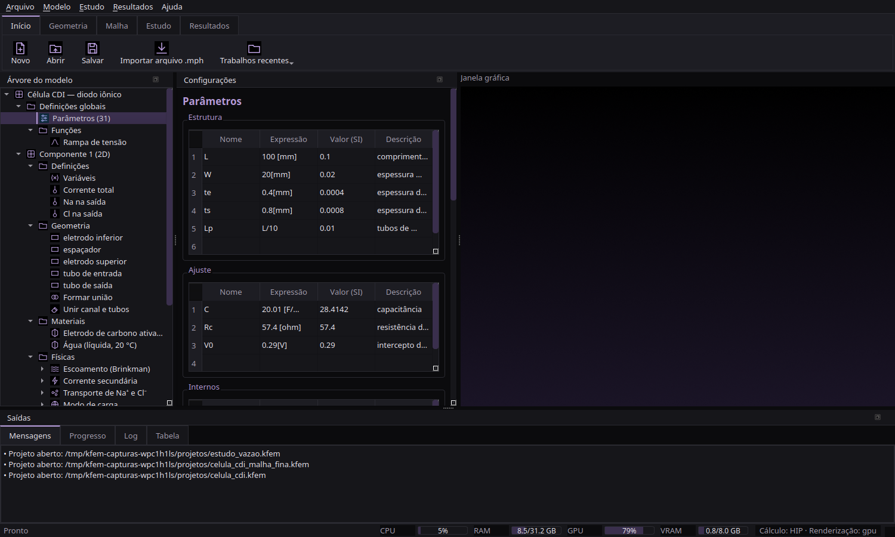

### 5.2 Expressões

Todos os campos numéricos aceitam expressões. A avaliação é segura: só operações matemáticas,
sem execução de código.

| Elemento | Sintaxe |
|---|---|
| Operações | `+ - * / ^` (potência) e parênteses |
| Unidades | entre colchetes, junto do número ou da expressão: `0.5[mm]`, `1[mol/L]*10^(-pH)`, `2.23e3[L/(mol*s)]` |
| Funções | `sqrt`, `abs`, `exp`, `log` (natural), `log10`, `sin`, `cos`, `tan`, `tanh`, `min(a,b)`, `max(a,b)` |
| Constantes | `pi`, `F_const` (Faraday), `R_const`, `N_A_const`, `k_B_const`, `e_const`, `epsilon0_const`, `g_const` (CODATA 2018) |
| Parâmetros | pelo nome |
| Funções do modelo | as definidas em **Funções** (§5.3), pelo nome |

As unidades seguem o pint: prefixos SI (`m`, `u` para micro, `n`…), unidades derivadas
(`N`, `Pa`, `J`, `W`, `C`, `V`, `S`, `F`, `mol`, `L`, `atm`, `K`…) e combinações. Uma expressão
com unidades inconsistentes é recusada.

### 5.3 Funções, variáveis e sondas

| Nó | Onde | Para que serve |
|---|---|---|
| **Degrau suave** | Definições globais → Funções | degrau de `from` a `to` em `location`, com largura de suavização `smooth` |
| **Função analítica** | Definições globais → Funções | função com argumentos (ex.: `x, t`) e expressão |
| **Variáveis** | Componente → Definições | tabela nome–expressão, avaliada no domínio |
| **Sonda: integral em domínio** | Componente → Definições | integral de uma expressão nos domínios selecionados, a cada instante |
| **Sonda: média em contorno** | Componente → Definições | média de uma expressão nos contornos selecionados, a cada instante |

As sondas aparecem na aba **Tabela** e no arquivo `globals.csv` do cálculo.

### 5.4 Materiais

Um **Material** guarda uma tabela de propriedades (nome, expressão) para os domínios
selecionados. As físicas leem essas propriedades com o prefixo `mat:`. Por exemplo, a
porosidade padrão da **Matriz porosa** é `mat:porosity`, e a viscosidade do fluido é
`mat:viscosity`. Isso permite trocar o material de um domínio sem mexer nas físicas.

## 6. Geometria

### 6.1 Primitivas e operações

| Nó | Propriedades | Observação |
|---|---|---|
| **Retângulo** | canto x, canto y, largura, altura | 2D |
| **Disco** | centro x, centro y, raio | 2D |
| **Polígono** | vértices `x y; x y; ...` | 2D; fecha sozinho do último vértice para o primeiro |
| **Bloco** | canto x, y, z; comprimentos x, y, z | 3D |
| **Diferença** | objetos a manter, objetos a subtrair | pelas etiquetas dos nós (ex.: manter `celula`, subtrair `eletrodo`) |
| **Interseção** | objetos | mantém só a parte comum |
| **Formar união** | — | funde tudo mantendo as interfaces internas: cada região vira um domínio |
| **Remover arestas internas** | arestas (numeração após a união) | junta domínios separados pelas arestas indicadas |

Os nós são executados de cima para baixo. As operações booleanas consomem os objetos que
usam; uma primitiva que não entra em nenhuma operação permanece como objeto próprio. A
sequência deve terminar em **Formar união**, que define os domínios e contornos finais.

As coordenadas estão na **unidade do componente** (padrão: mm; troque nas propriedades do
componente). Internamente a geometria é montada nessa unidade e só depois escalada para
metros. Assim, detalhes submicrométricos (uma camada de 0,4 µm num domínio de 100 µm, por
exemplo) não se perdem na tolerância do núcleo geométrico.

### 6.2 Exemplo: camada fina que acompanha uma superfície curva

Um semicírculo de raio R sobre uma base, com uma camada de espessura t colada à superfície,
recortado por uma célula retangular (é a geometria do exemplo 2D da §15.3):

| Ordem | Nó | Etiqueta | Propriedades |
|---|---|---|---|
| 1 | Retângulo | `celula` | célula inteira |
| 2 | Disco | `eletrodo` | raio R |
| 3 | Disco | `limite` | raio R + t |
| 4 | Retângulo | `celula2` | igual à célula |
| 5 | Interseção | `clip` | objetos `limite`, `celula2` |
| 6 | Diferença | `corte` | manter `celula`, `clip`; subtrair `eletrodo` |
| 7 | Formar união | `fin` | — |

O resultado tem dois domínios: a faixa de espessura t (a camada) e o resto da célula.

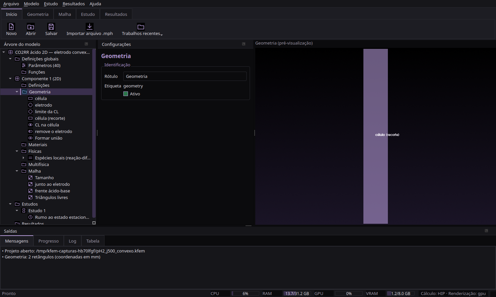

### 6.3 Numeração de domínios e contornos

Depois de **Formar união**, domínios e contornos recebem números a partir de 1, em ordem das
coordenadas da caixa envolvente (primeiro x mínimo, depois y mínimo; em empates, contornos
verticais antes dos horizontais). A numeração é estável enquanto a geometria não muda, mas
**acrescentar ou remover uma interface muda os números**. Confira-os sempre na malha
(**Malha → Gerar malha**, colorida por domínio) antes de escolher seleções. Em modelos
gerados por script, prefira identificar contornos pelas coordenadas (§13.3).

### 6.4 Pré-visualização

**Geometria → Pré-visualizar geometria** desenha os **retângulos** do componente com os seus
rótulos. Discos, polígonos e o resultado das booleanas não aparecem na pré-visualização:
gere a malha para ver a forma final. Geometrias muito alongadas ganham uma escala vertical só
no desenho, indicada no título ("escala vertical ×N"); o cálculo usa as dimensões reais.

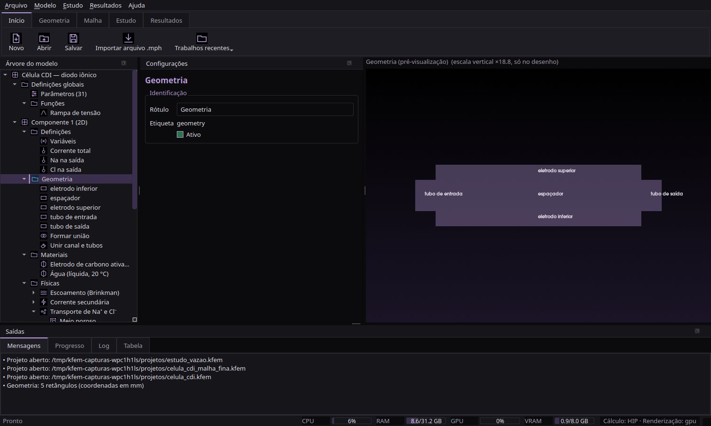

## 7. Malha

| Nó | Propriedades | Efeito |
|---|---|---|
| **Tamanho** | tamanho máximo, mínimo, taxa de crescimento, fator de curvatura | tamanho global dos elementos |
| **Tamanho local** | seleção de contornos; tamanho máximo, mínimo, taxa de crescimento, **largura da faixa fina** | refina junto aos contornos selecionados |
| **Triângulos livres** | seleção de domínios | gerador de triângulos (Gmsh) |
| **Camadas-limite** | número de camadas, fator de crescimento, espessura da 1ª camada | camadas estruturadas junto a contornos (importadas do `.mph`) |

Os tamanhos estão na unidade do componente. No **Tamanho local**, a **largura da faixa fina**
mantém o tamanho mínimo constante até essa distância do contorno; daí em diante o tamanho
cresce até o máximo. Exemplo do modelo 2D de CO₂: 0,1 µm numa faixa de 0,6 µm junto ao
eletrodo e 0,2 µm numa faixa de 15 µm junto ao eletrólito.

**Malha → Gerar malha** roda o Gmsh num processo separado e mostra a malha colorida por
domínio, com o número de elementos no título.

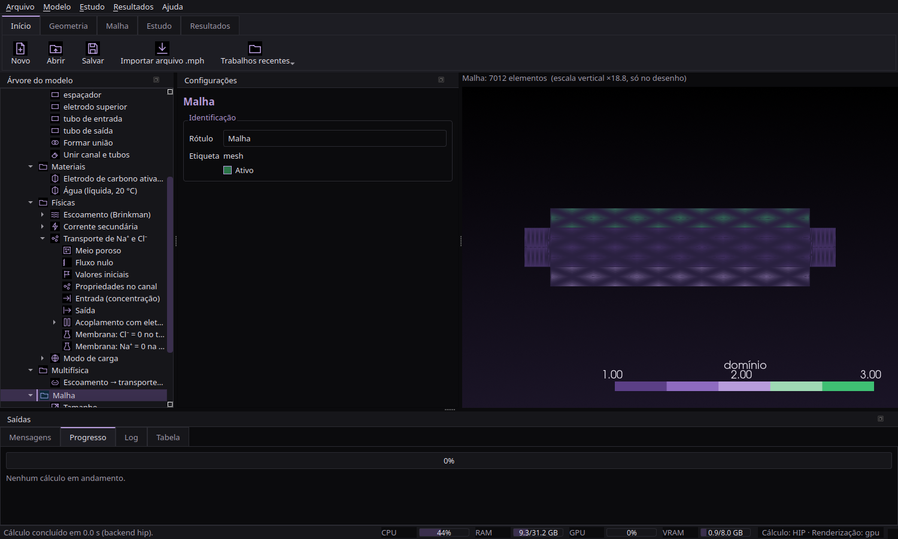

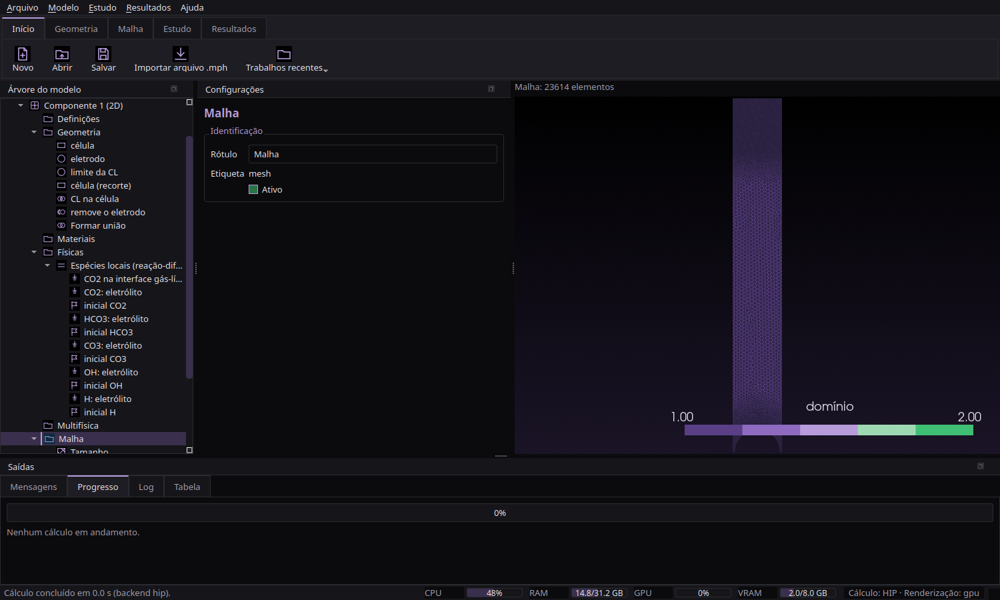

## 8. Físicas prontas

Cada física é um nó em **Físicas**, com seleção de domínios e filhos para condições de
domínio, contorno e valores iniciais. Os filhos marcados com "padrão" são criados junto com a
física e valem para tudo o que não tiver outra condição.

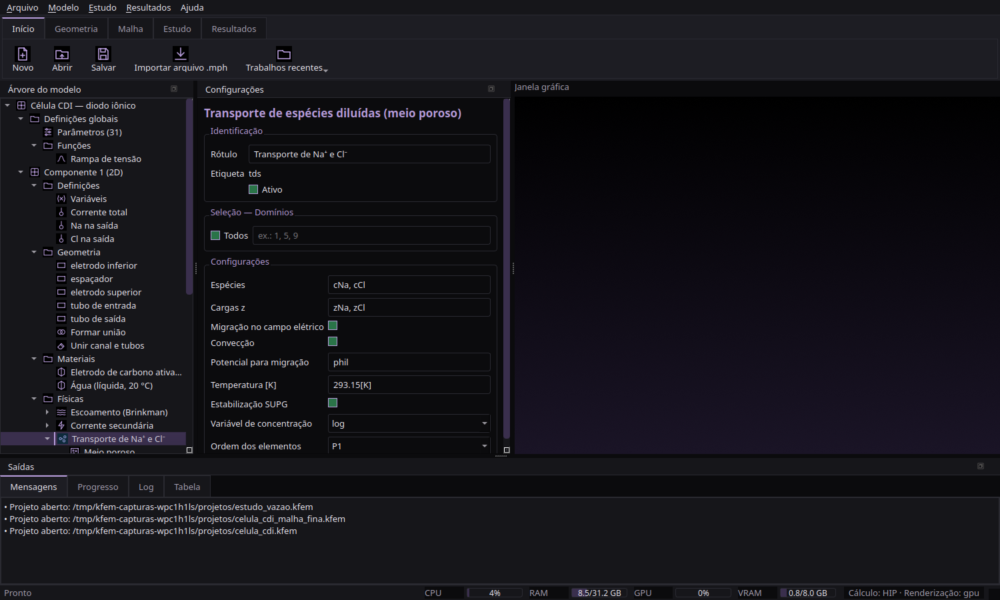

### 8.1 Escoamento em meio poroso (Brinkman)

Resolve velocidade **u** e pressão **p** em regiões livres e porosas.

| Opção ou filho | Propriedades |
|---|---|
| Física | desprezar inércia (Stokes–Brinkman); ordem dos elementos P2/P1 ou P3/P2 |
| Matriz porosa (padrão) | porosidade ε_p, permeabilidade κ |
| Fluido livre | domínios sem matriz porosa |
| Propriedades do fluido (padrão) | densidade ρ, viscosidade μ |
| Parede (padrão) | sem deslizamento |
| Entrada | velocidade normal de entrada U₀ |
| Saída | pressão p₀ |
| Valores iniciais (padrão) | velocidade e pressão iniciais |

### 8.2 Corrente secundária

Resolve o potencial do eletrólito φ_l e do sólido φ_s.

| Opção ou filho | Propriedades |
|---|---|
| Física | espessura fora do plano; ordem P1 ou P2 |
| Eletrólito (padrão) | condutividade σ_l |
| Eletrodo poroso | σ_l, fração de eletrólito ε_l, condutividade do sólido σ_s, fração de sólido ε_s, correção de condutividade (Bruggeman ou nenhuma) e expoente |
| ↳ Dupla camada (capacitiva) | área específica a_v, capacitância por área C_dl |
| ↳ Reação de eletrodo (Butler–Volmer linear) | corrente de troca i₀, área específica, potencial de equilíbrio, α anódico e catódico |
| Isolamento (padrão) | fluxo de corrente nulo |
| Potencial elétrico (sólido) | φ_s imposto |
| Valores iniciais (padrão) | φ_l e φ_s iniciais |

### 8.3 Transporte de espécies diluídas (meio poroso)

| Opção ou filho | Propriedades |
|---|---|
| Física | espécies, cargas z, migração no campo elétrico, convecção, potencial para migração, temperatura, estabilização SUPG, variável de concentração (`log`: resolve ln c, com positividade garantida; `linear`: resolve c), ordem P1 ou P2 |
| Propriedades de transporte (fluido livre) | difusividades e cargas |
| Meio poroso (padrão) | difusividades no fluido, cargas, porosidade, difusividade efetiva (Bruggeman ou nenhuma) |
| Fluxo nulo (padrão) | — |
| Valores iniciais (padrão) | concentrações iniciais |
| Entrada | concentrações de entrada |
| Saída | saída convectiva |
| Concentração imposta | espécies e valores |
| Acoplamento com eletrodo poroso | liga o transporte à corrente volumétrica do eletrodo |
| ↳ Coeficientes de reação | corrente volumétrica, elétrons n, coeficientes estequiométricos |

### 8.4 Equações globais e multifísica

- **Equações globais → Equações**: tabela de equações algébricas ou diferenciais em
  variáveis escalares (variável, f(...) = 0, valor inicial, unidade), resolvidas junto com os
  campos. Exemplo: o modo de carga com tensão efetiva do caso CDI.
- **Multifísica → Escoamento → transporte**: usa a velocidade da física de escoamento na
  convecção da física de transporte (pelas etiquetas, ex.: `br` e `tds`).

## 9. Equação personalizada (forma fraca)

Para resolver uma EDP sem módulo pronto, adicione em **Físicas** o nó **Equação personalizada
(forma fraca)** e escreva o **resíduo**: o KFem resolve "resíduo = 0" para toda função-teste.

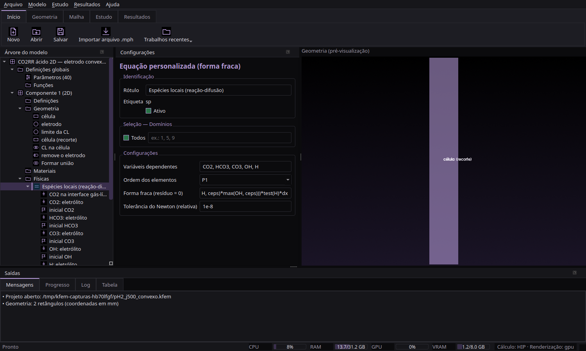

### 9.1 Campos

| Campo | Exemplo |
|---|---|
| Variáveis dependentes | `T`, ou várias: `CO2, HCO3, CO3, OH, H` |
| Ordem dos elementos | P1 ou P2 |
| Forma fraca (resíduo = 0) | `dt(T)*test(T)*dx + k*inner(grad(T), grad(test(T)))*dx - q*test(T)*dx` |
| Tolerância do Newton (relativa) | `1e-10` (padrão); `1e-8` basta para problemas muito rígidos |

### 9.2 Gramática

| Elemento | Significado |
|---|---|
| `test(u)` | função-teste da variável u |
| `dt(u)` | derivada no tempo (também de expressões: `dt(u*v)`) |
| `grad`, `div`, `curl`, `inner`, `dot` | operadores diferenciais e produtos |
| `vec(a, b)` | vetor com as componentes dadas |
| `x`, `y`, `z`, `t` | coordenadas (em metros) e tempo |
| `dx` | integral nos domínios da física |
| `dx(k)` | integral só no domínio k |
| `ds`, `ds(k)` | integral em todos os contornos ou no contorno k |
| `max(a,b)`, `min(a,b)`, `exp`, `log`, `sqrt`, `abs`… | funções matemáticas (§5.2) |
| parâmetros e unidades | como em qualquer expressão |

Nada além disso é aceito: não há execução de código. Termos de vários domínios entram
somados, por exemplo `D1*inner(grad(c), grad(test(c)))*dx(1) + D2*inner(grad(c), grad(test(c)))*dx(2)`.

### 9.3 Filhos do nó

| Filho | Uso |
|---|---|
| **Valor imposto (Dirichlet)** | variável e valor (pode depender de x, y, t) nos contornos selecionados |
| **Termo de contorno (Neumann/Robin)** | termo somado ao resíduo nos contornos selecionados, sem `ds`: `-g*test(T)` para fluxo g; `h*(T - Tinf)*test(T)` para convecção |
| **Termo de domínio adicional** | termo somado nos domínios selecionados, sem `dx` |
| **Valores iniciais** | variável e valor inicial |

No estudo, coloque a etiqueta da física (ex.: `wf`) em **Físicas resolvidas** de um passo
**Estacionário** ou **Dependente do tempo**.

### 9.4 Exemplos

**Poisson (verificado)**: −k ΔT = q num quadrado com T = 0 nas bordas.

```text
k*inner(grad(T), grad(test(T)))*dx - q*test(T)*dx
```

O máximo calculado reproduz o analítico, 0,07367·q/k.

**Calor transiente com convecção num contorno**: resíduo
`dt(T)*test(T)*dx + k*inner(grad(T), grad(test(T)))*dx`, mais um termo de contorno
`h*(T - Tinf)*test(T)` no contorno exposto e um valor inicial.

**Reação-difusão com várias espécies e concentrações sempre positivas nas taxas**: use
`max(c, ceps)` nos termos de reação (`ceps` = um piso pequeno, como 1e-15 mol/m³), como no
modelo de CO₂ da §15.2. Para garantir positividade em todo o domínio, resolva ln c (o
transporte pronto faz isso com a variável `log`).

## 10. Estudos

Um **Estudo** contém passos executados em sequência. Cada passo lista as **físicas
resolvidas** e os **acoplamentos ativos** (pelas etiquetas).

| Passo | Propriedades | Como resolve |
|---|---|---|
| **Estacionário** | físicas, acoplamentos | Newton (PETSc SNES, busca linear de retrocesso) com solver direto MUMPS |
| **Dependente do tempo** | físicas, acoplamentos, instantes de saída, tolerância relativa, ordem máxima BDF | BDF1 no primeiro passo e BDF2 de passo variável depois |
| **Varredura paramétrica** | parâmetros e listas de valores | ver §18 |

### 10.1 Instantes de saída e controle do passo

A lista de instantes aceita valores separados por espaço (`0 1e-5 1e-4 1e-3 0.01 0.1 1 10 60 120`)
ou `range(início, passo, fim)`. O passo de tempo interno é adaptativo: começa em uma fração
do intervalo, cresce enquanto o Newton converge e a estimativa de erro fica abaixo da
**tolerância relativa**, e é refeito com ¼ do tamanho quando o Newton falha. Muitos passos
rejeitados seguidos indicam uma frente muito íngreme ou o esgotamento de uma espécie.

### 10.2 Estado estacionário por transiente

Para problemas muito não lineares, um transiente até um tempo longo (com instantes de saída
espaçados em escala logarítmica) costuma chegar ao estado estacionário com mais segurança que
um Newton direto. Para confirmar o estacionário, compare os dois últimos instantes.

## 11. Resultados

### 11.1 Na interface

- **Resultados → Abrir resultados** carrega um diretório de cálculo (feito pela interface ou
  pela linha de comando).
- Na janela gráfica, escolha o **campo** e o **instante**. Campos das físicas prontas:
  `u` (velocidade), `p` (pressão), `phil` e `phis` (potenciais do eletrólito e do sólido) e
  as concentrações pelo nome das espécies. Na equação personalizada, os campos têm os nomes
  das variáveis dependentes.
- **Exportar imagem (PNG)** grava a vista; **Exportar tabela (CSV)** grava as sondas.

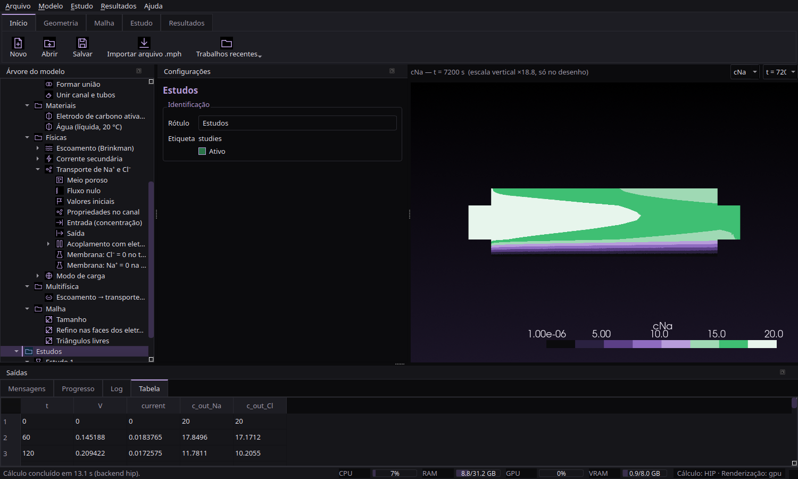

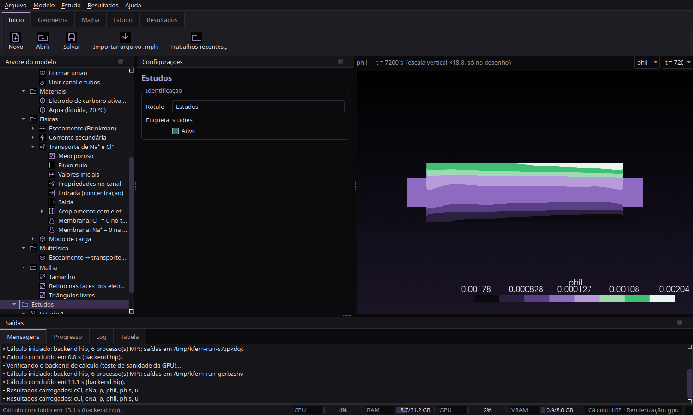

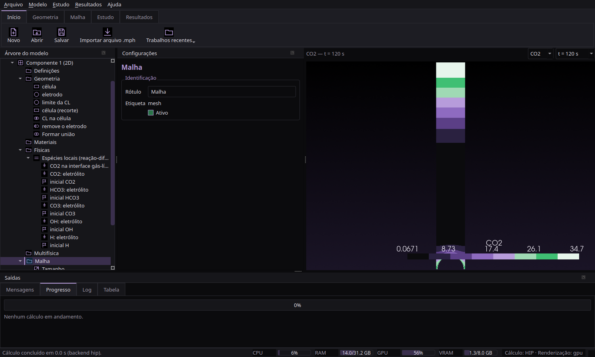

A aba **Tabela** recebe os valores das sondas a cada instante de saída.

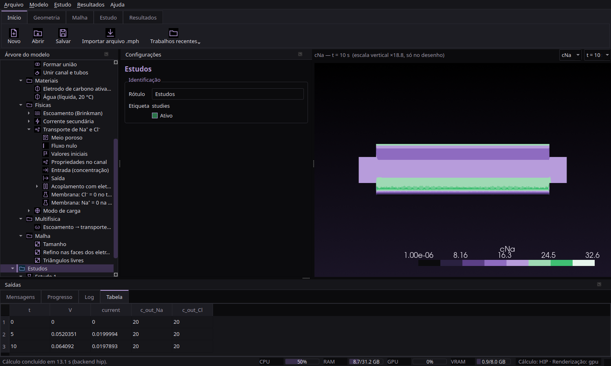

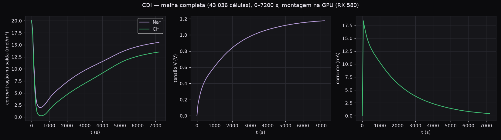

### 11.2 Arquivos de um cálculo

| Arquivo | Conteúdo |
|---|---|
| `mesh.xdmf` / `.h5` | malha com os marcadores de domínio e contorno |
| `field_<nome>.xdmf` / `.h5` | um campo por arquivo, com todos os instantes de saída (equação personalizada) |
| `fields.bp`, `flow.bp` | campos das físicas prontas (VTX/ADIOS2) |
| `globals.csv` | sondas e grandezas globais por instante |
| `summary.json` | tempos, backend usado, passos aceitos e rejeitados, iterações de Newton |
| `<projeto>.log` | log em JSON de linhas (quando o cálculo vem de `--solve` com a saída redirecionada) |

Os arquivos XDMF/HDF5 e VTX abrem no ParaView. Em Python, o `meshio` lê os XDMF (§13.4).

## 12. Linha de comando

### 12.1 Opções

| Comando | O que faz |
|---|---|
| `KFem-x86_64.AppImage [projeto.kfem]` | abre a interface (com o projeto, se dado) |
| `--solve projeto.kfem [-n N] [--workdir DIR]` | resolve sem interface, com N processos MPI; resultados em DIR |
| `--watch LOG DIR` | abre a interface acompanhando um cálculo já em execução |
| `--python script.py [args]` | roda um script com o Python e o KFem do pacote (§13) |
| `--import-mph arquivo.mph [-o saida.kfem]` | converte um `.mph` |
| `--diagnose [--no-sanity]` | mostra GPUs, drivers, backend escolhido e motivos |
| `--version` | versão |

### 12.2 Cálculos longos e em lote

Um cálculo longo pode rodar sem interface, com o log gravado em arquivo:

```bash
./KFem-x86_64.AppImage --solve caso.kfem --workdir caso > caso.log 2>&1
```

Para acompanhá-lo na interface, a qualquer momento:

```bash
./KFem-x86_64.AppImage --watch caso.log caso
```

A interface mostra o progresso, o log e os campos à medida que os instantes são gravados.
Fechar a janela não interrompe o cálculo.

Vários casos em paralelo, um processo por caso (use no máximo o número de núcleos físicos):

```bash
ls casos/*.kfem | xargs -P 6 -I{} sh -c './KFem-x86_64.AppImage --solve {} --workdir {}.res > {}.log 2>&1'
```

As pastas `Simulations/1D` e `Simulations/2D` do pacote de distribuição trazem um
`rodar.sh` pronto que faz isso e a análise depois.

## 13. Programação em Python

Tudo o que a interface monta pode ser montado por script, o que é útil para varreduras e
famílias de casos. Os scripts rodam com o Python do próprio KFem:

```bash
./KFem-x86_64.AppImage --python meu_modelo.py
```

### 13.1 Objetos principais

| Objeto | Módulo | Uso |
|---|---|---|
| `Model` | `kfem.model.tree` | o modelo: `parameters`, `comp` (componente), `studies`, `results`, `meta` |
| `Node(kind, tag, label, props=..., selection=...)` | `kfem.model.tree` | um nó da árvore; `add()` acrescenta filhos, `remove(tag)` remove |
| `Selection(dim, entities)` | `kfem.model.tree` | seleção: `Selection(2)` todos os domínios 2D; `Selection(1, [3, 7])` contornos 3 e 7 |
| `CATALOG[kind]` | `kfem.model.catalog` | especificação de cada tipo de nó; `.defaults()` dá as propriedades padrão |
| `save(model, caminho)` / `load(caminho)` | `kfem.io.kfem_format` | grava e lê `.kfem` |
| `generate(model)` | `kfem.geometry.build` | gera a geometria e devolve áreas e numeração de domínios e contornos |

O componente tem as seções `geometry`, `materials`, `physics`, `multiphysics`, `mesh` e
`definitions`, e a unidade de comprimento `length_unit`.

### 13.2 Exemplo completo

```python
from kfem.io.kfem_format import save
from kfem.model.catalog import CATALOG
from kfem.model.tree import Model, Node, Selection


def n(kind, tag, sel=None, **props):
    base = CATALOG[kind].defaults()
    base.update(props)
    return Node(kind, tag, CATALOG[kind].label, props=base, selection=sel)


m = Model(name="Placa aquecida")
m.parameters.add("k", "2[W/(m*K)]", "condutividade")
m.parameters.add("q", "10[W/m^3]", "fonte")
c = m.comp
c.length_unit = "m"
c.geometry.add(n("geom.rectangle", "r1", width="1", height="1"))
c.geometry.add(n("geom.form_union", "fin"))
wf = c.physics.add(n("physics.weakform", "wf", Selection(2), fields="T",
                     equation="k*inner(grad(T), grad(test(T)))*dx - q*test(T)*dx"))
wf.add(n("weakform.dirichlet", "d1", Selection(1), field="T", value="0"))
c.mesh.add(n("mesh.size", "size", hmax="0.04"))
c.mesh.add(n("mesh.triangles", "tri"))
st = m.studies.add(Node("study", "std1", "Estudo 1"))
st.add(n("step.stationary", "s1", physics=["wf"], couplings=[]))
save(m, "placa.kfem")
```

Depois: `--solve placa.kfem --workdir placa`, ou abra `placa.kfem` na interface.

### 13.3 Identificar contornos pelas coordenadas

Como a numeração depende da geometria (§6.3), um script robusto gera a geometria, lê as
coordenadas de cada contorno e escolhe pelos pontos extremos:

```python
import gmsh
from kfem.geometry.build import generate

geo = generate(m)                       # numeração em geo.boundaries: número KFem -> curva Gmsh
for num, tag in geo.boundaries.items():
    pts = gmsh.model.getBoundary([(1, tag)], oriented=False)
    print(num, [gmsh.model.getValue(0, p[1], []) for p in pts])
gmsh.finalize()
```

O exemplo 2D (`modelo2d.py`) usa essa técnica para achar o eletrodo, o topo e as paredes.

### 13.4 Ler resultados

```python
import meshio

with meshio.xdmf.TimeSeriesReader("placa/field_T.xdmf") as r:
    pontos, celulas = r.read_points_cells()
    t, dados, _ = r.read_data(r.num_steps - 1)   # último instante
T = next(iter(dados.values())).ravel()
print(t, T.max())
```

## 14. Importar do COMSOL (`.mph`)

**Arquivo → Importar arquivo .mph…** (ou `--import-mph`) converte um `.mph` seu para
`.kfem`: parâmetros, geometria, malha, físicas reconhecidas, estudos e o que mais for
possível. O resto aparece num relatório de itens não convertidos. A leitura serve só para
interoperabilidade com os seus próprios arquivos; nenhum código do COMSOL é usado. Detalhes
do que é suportado estão em `docs/mph-format/`, no código-fonte.

## 15. Exemplos prontos

### 15.1 Deionização capacitiva (CDI)

Célula de 100 mm × 1,2 mm com eletrodos porosos: Brinkman, corrente secundária com dupla
camada, transporte de Na⁺ e Cl⁻ com migração e convecção, e o modo de carga como equação
global. Arquivos em `exemplos/cdi/`; `cdi_quick.kfem` é a versão rápida para um primeiro
teste (cerca de 15 s de cálculo). Os campos são `cNa`, `cCl`, `phil`, `phis`, `u` e `p`.

### 15.2 Redução de CO₂ em meio ácido, 1D

Reprodução do modelo de Xie et al. (Nature Catalysis 5, 564–570, 2022): CO₂, HCO₃⁻, CO₃²⁻,
OH⁻ e H⁺ numa camada catalítica de 0,4 µm e numa camada de difusão de 100 µm, com os cinco
equilíbrios do carbonato, escritos como uma **Equação personalizada**. Estudo dependente do
tempo até 120 s. Pasta `Simulations/1D` (36 casos, `rodar.sh`, scripts e tutorial):

```bash
./KFem-x86_64.AppImage --python scripts/modelo.py pH3_j300.kfem 3 300
```

### 15.3 Redução de CO₂ em meio ácido, 2D: eletrodo plano, convexo e pontiagudo

O mesmo modelo com três formas de eletrodo de mesma área ativa (geometria da §6.2). Pasta
`Simulations/2D` (9 casos, 5 testes de malha, `rodar.sh` e tutorial):

```bash
./KFem-x86_64.AppImage --python scripts/modelo2d.py conico 2 500 pH2_j500_conico.kfem
```

Os tutoriais de cada pasta (`TUTORIAL_1D.pdf`, `TUTORIAL_2D.pdf`) descrevem os modelos, os
tempos de cálculo e os valores esperados para conferência.

## 16. Placa de vídeo (GPU)

### 16.1 O que a GPU faz no KFem

- **Desenho**: sempre que há driver de vídeo.
- **Cálculo**: a montagem das matrizes de elementos finitos dos modelos com as físicas prontas
  roda na GPU, compilada na hora para a placa presente (HIP). Na primeira iteração de cada
  cálculo o KFem monta na GPU e na CPU e compara. A GPU só continua se o resultado for igual
  (diferença relativa abaixo de 10⁻⁹) **e** ela for mais rápida. Senão o cálculo segue na CPU
  e o motivo vai para o Log.
- O sistema linear é resolvido na CPU (MUMPS), que nas medidas foi mais rápido que o solve
  na GPU.
- A **Equação personalizada** roda na CPU, com MUMPS.

Exemplo medido (RX 580, malha de 43 mil células, 6 processos): 40 s com montagem na GPU
contra 62 s só na CPU, com resultados idênticos. Em malhas pequenas a CPU costuma ganhar, e o
KFem escolhe sozinho.

### 16.2 Instalação automática

Na primeira vez que o KFem abre numa máquina com placa **AMD ou NVIDIA** sem cálculo na GPU
(falta driver ou runtime), ele **oferece instalar** o que falta. Aceitando, o sistema pede a
senha de administrador numa janela própria (o KFem não a vê), a saída aparece na aba **Log**
e, no fim, a placa é testada de novo. A oferta aparece uma vez só; para refazer:
**Ajuda → Configurar placa de vídeo…**.

| Placa | Ação automática |
|---|---|
| AMD | instala o runtime ROCm; põe o usuário nos grupos `render` e `video` (vale no próximo login) |
| NVIDIA sem driver | instala o driver recomendado (`ubuntu-drivers`); é preciso reiniciar |
| NVIDIA com driver | identifica modelo e *compute capability*; placas anteriores à Pascal (6.0) não têm suporte |
| Intel / outras | nada: o cálculo fica na CPU e a GPU desenha |

O instalador nunca roda `apt autoremove`, e só remove um pacote conflitante depois de dizer
qual e por quê.

### 16.3 Drivers por fabricante

O script `kfem-gpu-setup` identifica a placa e diz o que falta. Ele está no pacote de
distribuição (`kfem-gpu-setup.sh`) e dentro do AppImage:

```bash
./KFem-x86_64.AppImage --appimage-extract usr/bin/kfem-gpu-setup >/dev/null; ./squashfs-root/usr/bin/kfem-gpu-setup
```

Sem opções ele só mostra o plano; `--install` instala o runtime pelos pacotes da distribuição
(pede sudo); `--build` compila a variante para a sua placa a partir do código-fonte.

| Fabricante | O que instalar | Situação |
|---|---|---|
| **AMD** (Radeon) | driver `amdgpu` (já vem no kernel) + runtime ROCm. Ubuntu/Debian: `libamdhip64-5 libhsa-runtime64-1 libamd-comgr2 libhiprtc-builtins5 rocminfo librocsparse0 libhipsparse0 librocblas0 libhipblas0 librocsolver0 libhipsolver0 librocrand1 libhiprand1`. Usuário no grupo `render`: `sudo usermod -aG render,video $USER` e entrar de novo na sessão. | **Cálculo na GPU.** Testado na RX 580 (gfx803). Arquiteturas com bibliotecas ROCm do Ubuntu 24.04: gfx803, gfx900, gfx906, gfx908, gfx90a, gfx1010, gfx1030, gfx1100, gfx1101, gfx1102. |
| **NVIDIA** | driver proprietário (o instalador automático cuida disso). Para compilar a variante CUDA: `kfem-gpu-setup --install --build`. | Desenho na GPU; cálculo na CPU com o AppImage atual. A variante CUDA não foi testada em hardware real. |
| **Intel** | driver Mesa (já vem na distribuição) | Desenho na GPU; cálculo na CPU. |
| Sem GPU / máquina virtual | — | Tudo na CPU, com desenho por software (Mesa). |

Para ver o que o KFem escolheu:

```bash
./KFem-x86_64.AppImage --diagnose
```

O backend usado também aparece na barra de status, no Log e no `summary.json` de cada cálculo.

### 16.4 Variáveis de ambiente

| Variável | Valores | Efeito |
|---|---|---|
| `KFEM_GPU` | `auto` (padrão), `hip`, `cuda`, `opencl`, `cpu` | backend preferido para a variante do PETSc |
| `KFEM_GPU_ASM` | `auto` (padrão), `0`, `1` | montagem na GPU: automática, desligada ou forçada (mesmo se mais lenta) |
| `KFEM_GPU_SOLVE` | `1` | força o solve linear na GPU também com vários processos (experimental) |
| `OMP_NUM_THREADS` | número | threads OpenMP por processo (padrão 1) |

Depois de trocar de placa ou de driver, o teste da GPU se refaz sozinho. Para forçar, apague
`~/.cache/kfem/backend.json`.

## 17. Problemas comuns

| Sintoma | Causa e solução |
|---|---|
| "nenhum compilador C (gcc) encontrado" | instale o `gcc` (§2) |
| O AppImage não abre: erro de FUSE | rode com `--appimage-extract-and-run` ou instale o `fuse3` |
| "Permission denied" ao abrir | `chmod +x KFem-x86_64.AppImage`, ou copie do HD externo para o disco interno |
| A barra de status diz "Cálculo: CPU" numa placa AMD | rode `kfem-gpu-setup`: falta o runtime ROCm, o usuário fora do grupo `render` ou a arquitetura não é suportada. Veja `--diagnose`. |
| Log: "montagem na CPU foi mais rápida" | normal em malhas pequenas ou com muitos processos dividindo a GPU |
| Log: "montagem na GPU difere da CPU" | a conferência protegeu o cálculo, que seguiu na CPU. Informe o caso com o log. |
| A pré-visualização mostra só retângulos | discos, polígonos e booleanas só aparecem na malha (§6.4) |
| Uma condição de contorno caiu no lugar errado | a numeração mudou porque a geometria mudou (§6.3); confira na malha ou identifique por coordenadas (§13.3) |
| Newton não converge no estacionário | resolva por um transiente até tempo longo (§10.2), refine a malha na região de gradiente forte ou reduza a tolerância para `1e-8` |
| Passos rejeitados no transiente | o controle de passo reduz o dt e continua. Muitos seguidos indicam frente íngreme ou esgotamento de espécie. |
| Concentração levemente negativa perto de uma frente | artefato de variáveis primitivas; refine a malha ali ou use a variável `log` (transporte pronto) |

## 18. Limites conhecidos

- **Varredura paramétrica**: o nó existe (e vem na importação de `.mph`), mas o solver ainda
  não o executa. Para varreduras, gere os casos por script (§13) e rode-os em lote (§12.2).
- **Pré-visualização da geometria**: desenha só retângulos (§6.4).
- **Camadas-limite**: aplicadas só a modelos importados de `.mph` que as pedem.
- **3D**: o Bloco cria geometria 3D, mas as físicas foram verificadas só em 2D.
- **GPU**: montagem só para integrais de célula e só em GPUs HIP (AMD); a equação
  personalizada roda na CPU. Sem variante CUDA (NVIDIA) no pacote.
- **Sistemas**: testado no Ubuntu 24.04. Debian 13 e Fedora 40+ são compatíveis pela glibc,
  mas não foram testados.

## 19. Formato de projeto `.kfem`

O `.kfem` é um arquivo zip com `model.json`, que guarda a árvore completa (parâmetros,
funções, componente com geometria, materiais, físicas e malha, estudos e resultados) de forma
legível e versionada, e, quando há, a malha em XDMF/HDF5. Pode ser lido e alterado por
script (§13) ou por qualquer ferramenta que leia zip e JSON.

## 20. Licença

KFem é software livre sob a GPL-3.0-or-later. As licenças dos componentes incluídos estão em
`usr/share/licenses/` dentro do AppImage e em `THIRD_PARTY_NOTICES.md`.

## 21. Glossário

| Termo | Significado |
|---|---|
| AppImage | arquivo único executável que contém o programa e suas bibliotecas |
| Backend de cálculo | onde roda a álgebra do PETSc: CPU, HIP (AMD), CUDA (NVIDIA) ou OpenCL |
| BDF2 | método implícito de 2ª ordem para a integração no tempo, com passo variável |
| Bruggeman | correção da difusividade ou condutividade efetiva em meio poroso: ε^1,5 |
| Conferência da GPU | comparação, na 1ª iteração, da montagem feita na GPU com a da CPU |
| Dirichlet | condição de contorno que fixa o valor da variável |
| DOLFINx / FEniCSx | biblioteca livre de elementos finitos usada pelo KFem |
| Etiqueta | nome curto e único de um nó, usado para referenciá-lo |
| Forma fraca | a EDP multiplicada por uma função-teste e integrada; é o que a equação personalizada recebe |
| JIT | compilação na hora dos núcleos de cada modelo (precisa do `gcc`) |
| MPI | processos em paralelo, cada um com uma parte da malha |
| MUMPS | solver direto (fatoração LU) usado nos sistemas lineares |
| Montagem | cálculo das matrizes e vetores de elementos finitos, célula por célula |
| Neumann / Robin | condições de contorno de fluxo imposto / fluxo proporcional ao valor |
| Newton | método iterativo para as equações não lineares de cada passo |
| ROCm / HIP | plataforma de cálculo das GPUs AMD |
| Seleção | conjunto de domínios ou contornos onde um nó age |
| Sonda | grandeza integral ou média avaliada a cada instante |
| SUPG | estabilização numérica para transporte dominado por convecção |
| XDMF/HDF5 | formato aberto dos campos de resultado, lido no ParaView |
