# Tutorial do KFem

## Antes de começar

Neste tutorial você vai, do início ao fim:

1. instalar o KFem e conferir se a placa de vídeo será usada;
2. trazer o seu modelo da célula de deionização capacitiva (CDI) — importando o `.mph` do
   COMSOL ou abrindo um `.kfem`;
3. revisar parâmetros, física, geometria e malha;
4. rodar um transiente curto de teste e acompanhar o cálculo;
5. ver e exportar os resultados;
6. rodar o cálculo longo sem a interface.

Tempo estimado: 30 minutos, mais o tempo do cálculo longo. As telas são do KFem 0.1 numa
máquina com placa AMD Radeon RX 580.

> Os comandos de terminal estão em caixas cinzas. Copie e cole um por vez.

## Passo 1 — Instalar e abrir

O KFem é um arquivo só, o `KFem-x86_64.AppImage`. Dê permissão de execução:

```bash
chmod +x KFem-x86_64.AppImage
```

O KFem compila os núcleos de cada modelo na hora e precisa do compilador C do sistema. No
Ubuntu ou Debian:

```bash
sudo apt install gcc
```

Abra o programa com dois cliques no arquivo ou pelo terminal:

```bash
./KFem-x86_64.AppImage
```

## Passo 2 — Conferir a placa de vídeo

Rode o diagnóstico:

```bash
./KFem-x86_64.AppImage --diagnose
```

No fim aparece o backend escolhido. Numa placa AMD com ROCm, a saída termina assim:

```
Seleção de cálculo (KFEM_GPU=auto):
  ✘ cuda    nenhuma GPU NVIDIA
  ✔ hip     libamdhip64 em /usr/lib/x86_64-linux-gnu/libamdhip64.so; sanidade: erro relativo 7.1e-14 em 1002 iterações

Backend de cálculo escolhido: hip
Renderização: gpu
```

Se aparecer **cpu** numa placa AMD, falta o runtime ROCm. O próprio KFem traz um assistente
que identifica a placa e mostra o que instalar:

```bash
./KFem-x86_64.AppImage --appimage-extract usr/bin/kfem-gpu-setup >/dev/null; ./squashfs-root/usr/bin/kfem-gpu-setup
```

Sem opções ele só mostra o plano. Para instalar o runtime (pede sua senha de administrador),
rode de novo com `--install`. Placas NVIDIA e Intel calculam na CPU nesta versão e usam a GPU
para desenhar.

## Passo 3 — Trazer o seu modelo

**Se você tem o arquivo do COMSOL:** **Arquivo → Importar arquivo .mph…** e escolha o
`CDI_ionic_diode.mph`. A mensagem embaixo informa quantos itens foram convertidos; a aba
**Log** lista o que não pôde ser convertido. Salve logo em seguida com **Arquivo → Salvar
como…** (por exemplo, `celula_cdi.kfem`).

**Se você já tem um `.kfem`:** **Início → Abrir** (Ctrl+O).

Da próxima vez, o projeto aparece em **Início → Trabalhos recentes**:

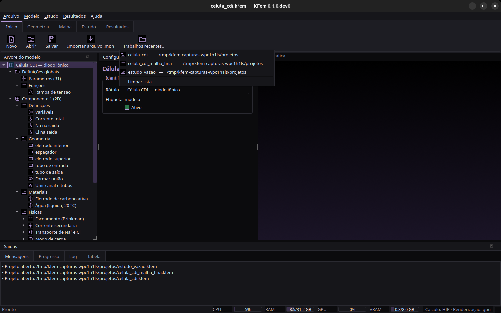

Com o projeto aberto, a árvore do modelo (à esquerda) mostra tudo o que o compõe:

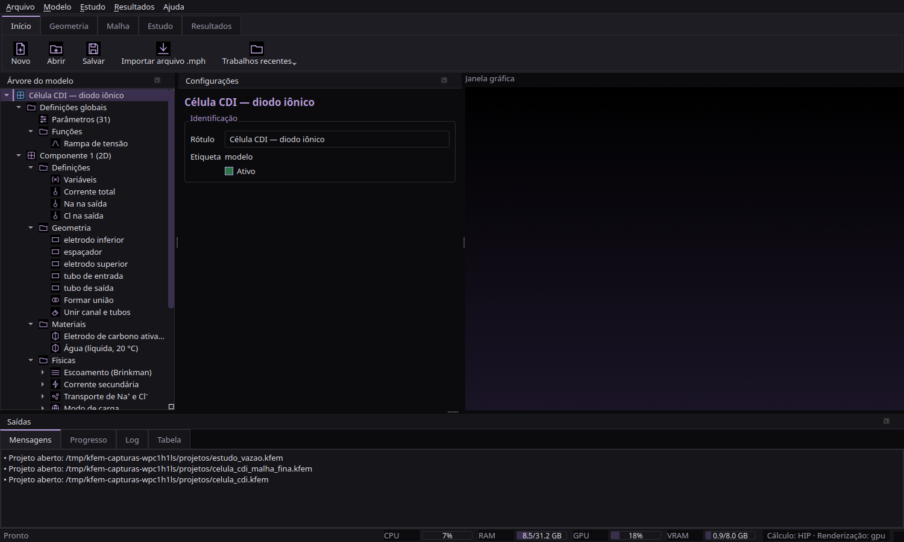

## Passo 4 — Revisar os parâmetros

Clique em **Definições globais → Parâmetros**. A tabela mostra nome, expressão, valor
convertido para o SI e descrição, separados nos grupos do modelo (Estrutura, Ajuste,
Internos, Operação…).

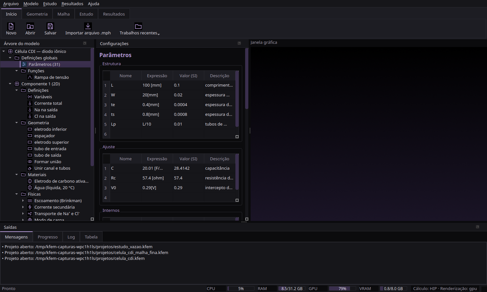

Para mudar um valor, dê dois cliques na coluna **Expressão** e digite com a unidade entre
colchetes, por exemplo `0.3[V]` ou `0.5[mm]*W`. O valor em SI é recalculado na hora. Só
operações matemáticas são aceitas; nenhum código é executado.

## Passo 5 — Revisar a física

Abra **Físicas** e clique em **Transporte de Na⁺ e Cl⁻**. O painel do centro mostra as
espécies, as cargas, se há migração no campo elétrico e convecção, e as opções numéricas.

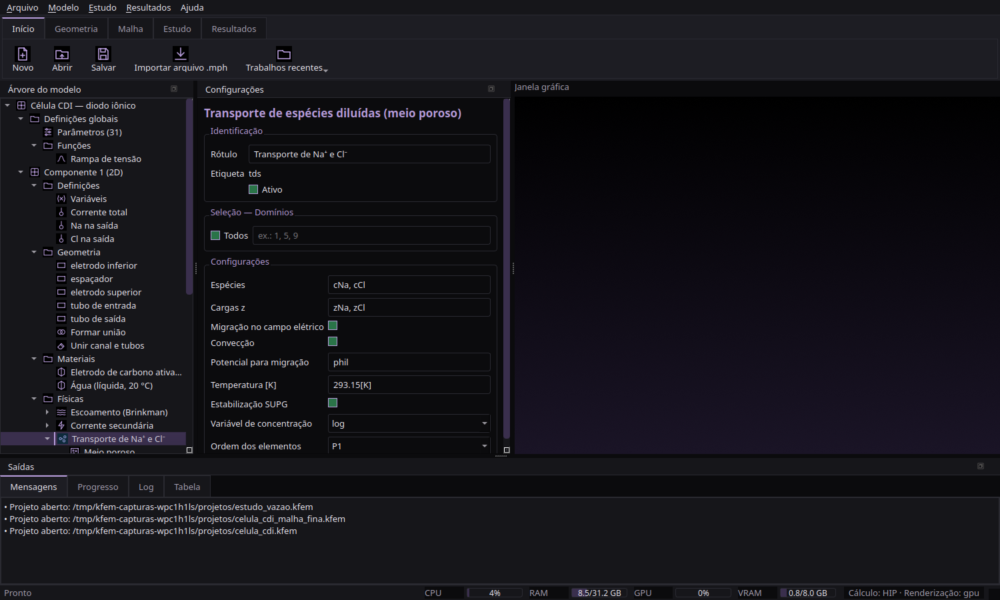

Cada física tem filhos (condições de contorno, propriedades do meio, valores iniciais). Clique
com o botão direito num nó para **adicionar**, **desativar** ou **remover** itens. Um item
desativado é ignorado no cálculo sem ser apagado.

## Passo 6 — Geometria e malha

Clique em **Geometria → Pré-visualizar geometria**:

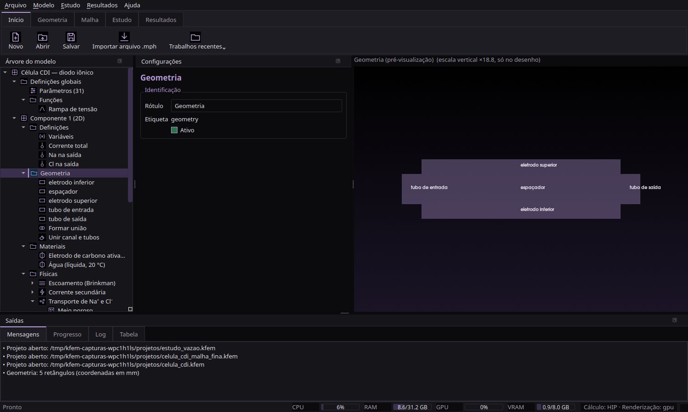

A célula tem 100 mm × 1,2 mm. Para não virar uma linha na tela, o KFem estica a vertical só
no desenho e avisa no título ("escala vertical ×18.8").

Agora **Malha → Gerar malha**. A malha é gerada num processo separado e aparece colorida por
domínio:

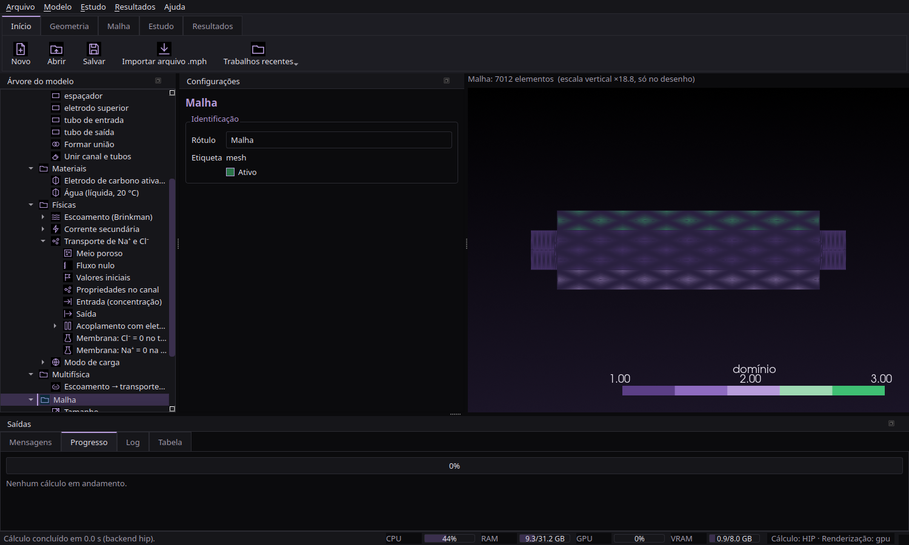

Para refinar, ajuste os nós dentro de **Malha** (Tamanho, Tamanho local, Camadas-limite) e
gere de novo.

## Passo 7 — Preparar um teste rápido

Antes do cálculo longo, rode alguns segundos simulados para conferir que está tudo certo.
Abra **Estudos → Estudo → Dependente do tempo** e mude **Instantes de saída** para:

```
range(0,5,10)
```

Isso pede saídas de 0 a 10 s, a cada 5 s. Salve (Ctrl+S).

## Passo 8 — Calcular

Na aba **Estudo**, confira **Processos MPI** (o padrão é o número de núcleos físicos) e
deixe **Threads OpenMP** em 1. Clique em **Calcular** (F8).

A aba **Progresso** mostra o instante simulado e o passo de tempo:

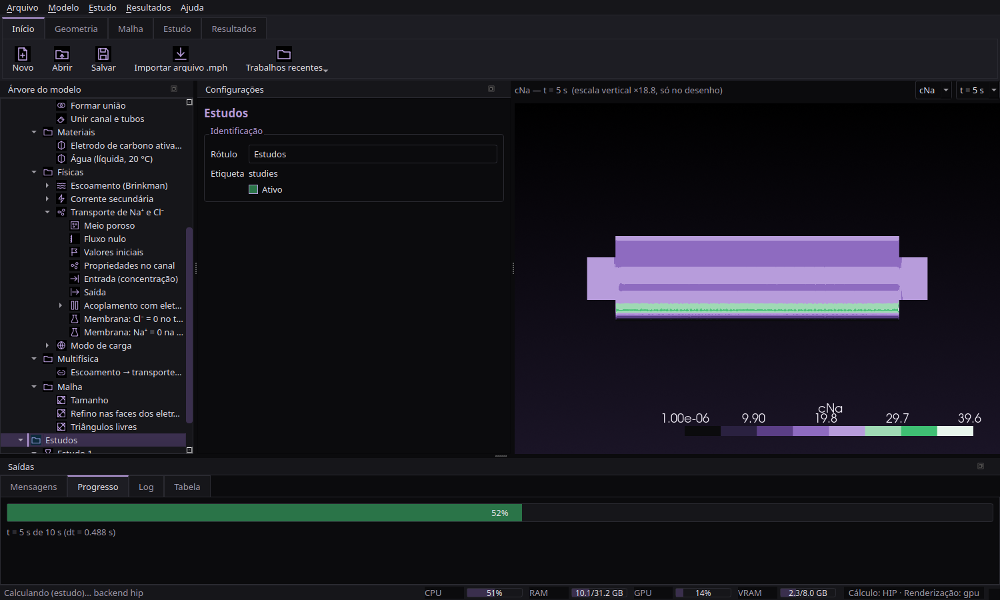

A interface continua livre durante o cálculo. **Parar cálculo** (Shift+F8) interrompe num
ponto seguro.

Ao terminar, veja a aba **Log**:

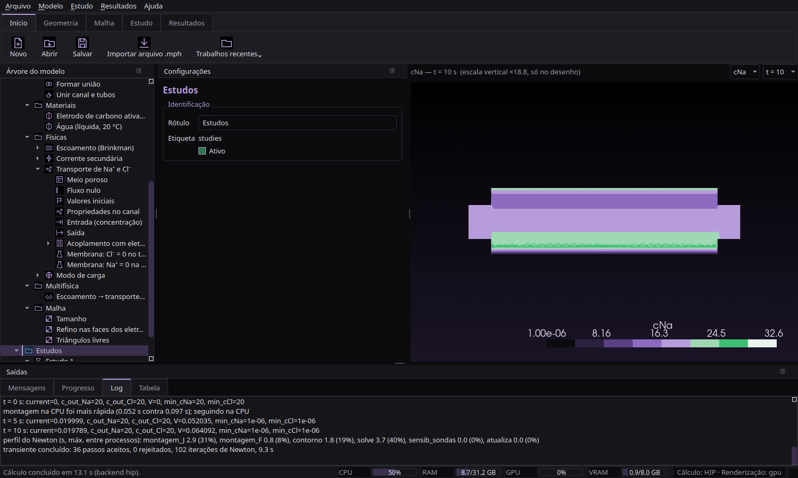

Duas linhas dizem como a GPU foi usada:

- "montagem na GPU conferida (…); 0,195 s contra 0,313 s na CPU": a GPU calculou as matrizes
  e o resultado foi conferido contra a CPU;
- "montagem na CPU foi mais rápida": a malha é pequena demais para compensar; o KFem seguiu na
  CPU sozinho. É o normal neste teste rápido.

## Passo 9 — Ver os resultados

Quando o cálculo termina, os campos aparecem na janela gráfica. Escolha o **campo** e o
**instante** nas caixas acima do desenho:

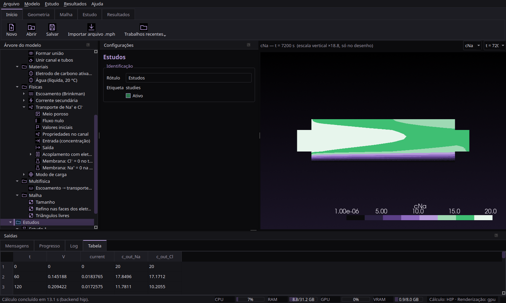

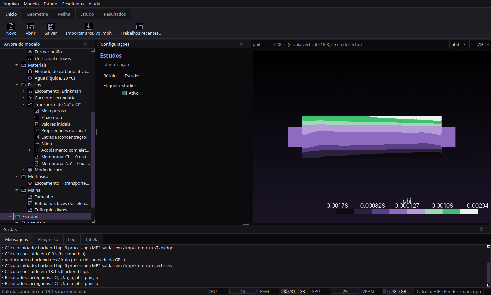

A aba **Tabela** tem as sondas — tensão, corrente e concentração na saída — a cada instante:

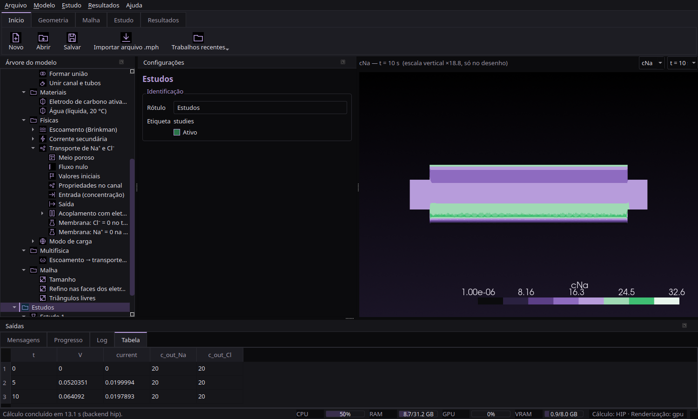

Para levar para um relatório: **Resultados → Exportar imagem (PNG)…** e **Resultados →
Exportar tabela (CSV)…**. Os campos completos ficam em XDMF/HDF5 no diretório do cálculo e
abrem no ParaView.

## Passo 10 — O cálculo longo, sem a interface

Volte os **Instantes de saída** para o intervalo completo, por exemplo `range(0,60,7200)`, e
salve. Cálculos de horas rodam melhor pelo terminal:

```bash
./KFem-x86_64.AppImage --solve celula_cdi.kfem -n 6 --workdir resultados_7200s
```

O `-n 6` usa 6 processos. A montagem na GPU entra sozinha quando compensa. Para acompanhar
na interface um cálculo que já está rodando, salve a saída num arquivo e use `--watch`:

```bash
./KFem-x86_64.AppImage --solve celula_cdi.kfem -n 6 --workdir resultados_7200s > calculo.log
```

```bash
./KFem-x86_64.AppImage --watch calculo.log resultados_7200s
```

Na máquina de referência (RX 580, 6 processos, 43 mil elementos), 7200 s simulados levaram
1 h 14 min:

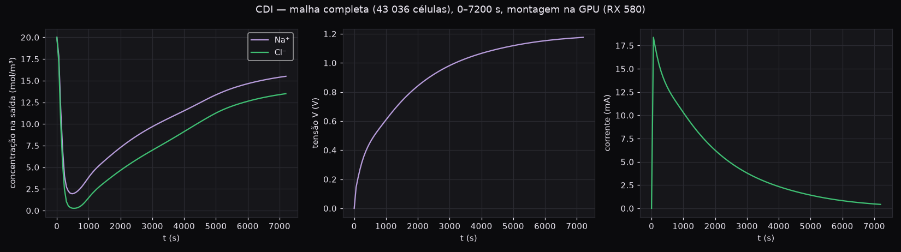

Depois, abra os resultados na interface com **Resultados → Abrir resultados** e escolha o
diretório `resultados_7200s`.

## Se algo der errado

| O que aparece | O que fazer |
|---|---|
| "nenhum compilador C (gcc) encontrado" | `sudo apt install gcc` |
| Erro de FUSE ao abrir o AppImage | `./KFem-x86_64.AppImage --appimage-extract-and-run` |
| "Cálculo: CPU" na barra de status, com placa AMD | rode o `kfem-gpu-setup` (Passo 2) |
| Muitos "passo rejeitado" no Log | normal na fase em que a concentração nos eletrodos zera; o passo de tempo é reduzido e o cálculo segue |
| "montagem na GPU difere da CPU" | a conferência protegeu o resultado e o cálculo seguiu na CPU; guarde o Log e informe |

O manual do usuário traz a referência completa: todos os nós da árvore, as variáveis de
ambiente, os formatos de arquivo e os detalhes do uso da GPU.
